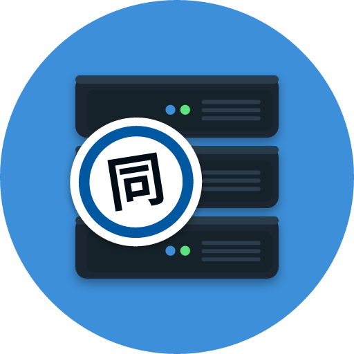

# Dōchō Server



A self-hosted server for Dōchō: **Suwayomi**'s reader and Mihon extensions, with **Kavita**-style
libraries, series groups, collections and Dōchō Sync built in. One server for reading online
sources and your own files, in the browser and in the app.

| Folder | What it is |
| --- | --- |
| `server/` | Suwayomi-Server v2.4.2366 (a squashed git subtree) plus Dōchō's additions in `server/src/main/kotlin/suwayomi/tachidesk/docho/` |
| `server-webui/` | Suwayomi-WebUI v20260929.01 (subtree) plus `src/features/docho/` |
| `server-docker/` | Dockerfile and compose file |

## Run it

```sh
cd server-docker
docker compose up -d --build
```

Open `http://<host>:4567`. The compose file mounts `/mnt/usb/Books` read-only at `/books`; change
that line for your library. Data (database, covers, extensions, settings) lives in the `data`
volume.

## What it adds to Suwayomi

**Libraries** (sidebar → Libraries). Like Kavita: name a library, pick its type (Manga, Comic,
Book, Light novel, Image) and folders, and it is scanned into series:

- a folder per series; files are volumes and chapters, read from names such as
  `One-Punch Man v23 (2021) (Digital) (1r0n).cbz` or `Dandadan Vol. 3 Ch. 21.5.cbz`, Japanese
  `第5巻` and volume folders included; specials from `SP01`, `Omake`, `Specials/` and so on
- book libraries: each EPUB or PDF is a series, unless its metadata names a series
- ComicInfo.xml and EPUB/PDF metadata for titles, numbers, authors, genres, age rating, year
- CBZ/ZIP, CBR/RAR, CB7/7Z, folders of images, PDF (pages rendered on the server), and EPUB
  (picture books as their images; text laid out as pages, so books read in the same reader)
- settings per library: file types, exclude patterns, metadata on/off, collections from
  ComicInfo SeriesGroup or from folders, series groups from metadata, folder watching, a scan
  schedule, dashboard and search inclusion
- each library is a source (Browse → Sources) and a category of the same name; its series are
  in the library automatically. A scan only opens files that changed. If a library folder is
  missing or empty (an unmounted drive), the scan stops rather than removing everything.

**Series groups** (sidebar → Series groups). Several series read as one, such as JoJo's
Bizarre Adventure's parts:

- the group is a series of its own (the Series Groups source), so it reads in the WebUI and in
  the app like any other; its chapters are the parts' chapters in order
- order the parts by hand, by part/season number, by year or by name
- name each part ("Shown as"), or let the server name them: *JoJo's Bizarre Adventure Part 3 -
  Stardust Crusaders* becomes *Part 3: Stardust Crusaders*
- chapter names: `Stardust Crusaders · Vol. 3`, numbered straight through (`Vol. 15`), both,
  or unchanged
- reading a chapter in the group marks it in its own series too, and back
- the parts can be hidden from the library while grouped; ungrouping brings them back
- suggestions from series whose titles start the same

**Collections** (sidebar → Collections), as in Kavita: made by hand, from ComicInfo
SeriesGroup, or from a book library's folders.

**Dōchō Sync** is built in at `/api/docho/sync/v1`, with the same behaviour as the standalone
`sync-server/`. In the app, set Dōchō Sync's address to this server (`http://<host>:4567`);
the app finds the built-in sync by itself. Sync accounts are separate from the server's own
login. The first account can be made by anyone who reaches the server; set
`DOCHO_SYNC_REGISTRATION=open` to allow more. Devices moving from the standalone server merge
again on their first sync, so nothing needs copying over.

**In the app**: Settings → Sync / Self-hosted sources → *Dōchō Server / Suwayomi*. Its
libraries and Series Groups appear under Browse → Sources with the server's extensions.

## API

GraphQL at `/api/graphql`, Suwayomi's schema plus:

- queries: `dochoLibraries`, `dochoLibrary`, `dochoFolders`, `dochoSeriesGroups`,
  `dochoSeriesGroup`, `dochoGroupSuggestions`, `dochoSuggestLabels`, `dochoCollections`,
  `dochoCollection`, `dochoSeriesInfo`, `dochoServerInfo`
- mutations: `create/update/deleteDochoLibrary`, `scanDochoLibrary`, `scanAllDochoLibraries`,
  `create/update/deleteDochoSeriesGroup`, `setDochoSeriesGroupMembers`,
  `setDochoSeriesGroupLabel`, `autoLabelDochoSeriesGroup`, `create/update/deleteDochoCollection`,
  `setDochoCollectionSeries`, `addToDochoCollection`, `removeFromDochoCollection`

## Building without Docker

```sh
cd server && ./gradlew :server:shadowJar          # server/build/*.jar (needs JDK 21+)
cd server-webui && pnpm install && pnpm build      # server-webui/build
```

Run the jar with `-Dsuwayomi.tachidesk.config.server.webUIFlavor=CUSTOM` and copy
`server-webui/build` to `<data folder>/webUI`, as `entrypoint.sh` does.

## Updating from upstream

```sh
git subtree pull --prefix=server https://github.com/Suwayomi/Suwayomi-Server.git <tag> --squash
git subtree pull --prefix=server-webui https://github.com/Suwayomi/Suwayomi-WebUI.git <tag> --squash
```

Dōchō's changes to upstream files are small and marked "Dōchō": `Page.kt`, `Manga.kt`,
`Library.kt`, `Downloader.kt`, `ServerSetup.kt`, `JavalinSetup.kt`, `TachideskGraphQLSchema.kt`,
the WebUI's `App.tsx`, `AppRoute.constants.ts` and `NavigationBar.constants.ts`. Three stub
classes in `AndroidCompat/.../android/net/` stand in for ones missing from the Android stub jar
the build downloads.

## Licence

Suwayomi-Server and Suwayomi-WebUI are MPL-2.0, and so are Dōchō's additions to them.
Kavita (GPL-3.0) is the model for the library features; none of its code is used.
